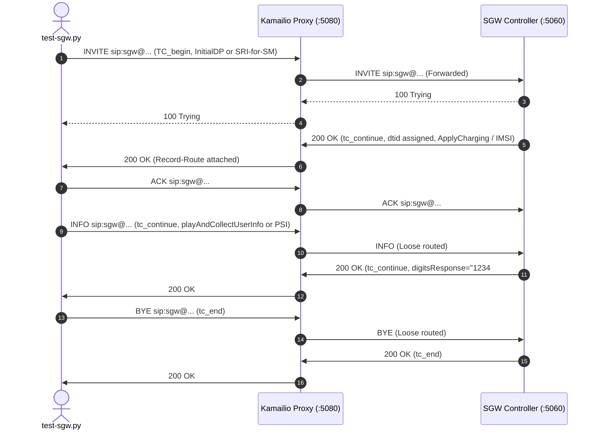

# SIP Proxy & Application Stack Demo

This demo instruments a complete, production-style SIP environment running inside Docker:

```
+------------------------------------+
|  SIP Client / UAC                  |
|  (Linphone / test-call.py)         |
+-----------------+------------------+
                  |  SIP/2.0/TCP :5080
                  v
+-----------------+------------------+
|  Edge SIP Proxy (Kamailio 6.0)     |
|  Container: demo-sip-proxy         |
|  - Max-Forwards & Sanity check     |
|  - Record-Route insertion          |
|  - In-dialog loose routing         |
+-----------------+------------------+
                  |  SIP/2.0/UDP (internal docker bridge)
                  v
+-----------------+------------------+
|  Unified Micronaut SIP App         |
|  Container: demo-sip-app           |
|  - AnnouncementController (NetAnn) |
|  - EarlyMediaController            |
|  - MailboxController (Voicemail)   |
|  - CallController & VxmlController |
|  - RegistrationController          |
+------------------------------------+
```

---

## 1. Quick Start

### Start the Stack

From this directory (`demo/`):

```bash
docker compose up -d
```

### Check Container Status & Health

```bash
# Check container status
docker compose ps

# Check HTTP management health endpoint
curl http://localhost:8080/health
# Returns: {"status":"UP"}

# View live proxy and application logs
docker compose logs -f
```

---

## 2. Testing with Linphone

Linphone is already installed on the host. Because Linphone may already be bound to UDP port `5060` on the host, the Kamailio proxy is exposed on port **`5080`** (`0.0.0.0:5080`).

### Method A: Direct Dialing (No Account Setup Required)

In Linphone's top search / dial bar, enter any of the following URIs and click **Call**:

| Service | Dial URI | Expected Flow |
|---|---|---|
| **NetAnn Announcement** | `sip:annc@127.0.0.1:5080;transport=tcp` | Plays 440 Hz audio announcement via NetAnn and hangs up |
| **Early Media Demo** | `sip:early-media@127.0.0.1:5080;transport=tcp` | Sends `183 Session Progress` with early media ringback before answer |
| **Voicemail Mailbox** | `sip:mailbox@127.0.0.1:5080;transport=tcp` | Connects interactive voicemail greeting |
| **General Call** | `sip:alice@127.0.0.1:5080;transport=tcp` | Sends `180 Ringing`, followed by `200 OK` answer |

> **Note on Transport**: Modern SIP clients like Linphone seamlessly support TCP transport when `;transport=tcp` is specified.

---

### Method B: Configuring a Dedicated Account in Linphone

If you want to configure Linphone with the proxy as your outbound gateway:

1. Open **Linphone Preferences** (Settings ➔ Accounts).
2. Click **Add Account** (or **Use a SIP Account**).
3. Fill in:
   - **Username**: `linphone-user`
   - **SIP Domain / Proxy**: `127.0.0.1:5080`
   - **Transport**: `TCP`
   - **Registration**: Enabled or disabled (both work; `RegistrationController` in `sip-app` accepts registrations).
4. With this account active, you can simply dial short numbers/names directly: `annc`, `early-media`, `mailbox`, `alice`.

---

## 3. Automated Test Script (`test-call.py`)

A standalone Python test client [`test-call.py`](test-call.py) is included to verify end-to-end SIP signaling through the proxy:

```bash
# Test RFC 4240 NetAnn announcement
python3 demo/test-call.py annc

# Test RFC 3960 Early Media (183 Session Progress -> 200 OK)
python3 demo/test-call.py early-media

# Test Interactive Voicemail Mailbox
python3 demo/test-call.py mailbox

# Test CallController (180 Ringing -> 200 OK)
python3 demo/test-call.py alice

# Test Dummy Signalling Gateway (TCAP over SIP: INVITE TC_begin -> INFO tc_continue -> BYE tc_end)
python3 demo/test-sgw.py --transport tcp
```

### Example Call Flow Output

```text
[*] Connecting TCP to 127.0.0.1:5080...
[*] Sending INVITE over TCP to Proxy: 127.0.0.1:5080
[*] Target URI: sip:early-media@127.0.0.1:5080

[<] Received SIP message:
SIP/2.0 100 trying -- your call is important to us (from Kamailio)

[<] Received SIP message:
SIP/2.0 183 Session Progress (from EarlyMediaController with SDP offer)
Record-Route: <sip:127.0.0.1:5080;transport=tcp;ftag=...;lr=on>

[<] Received SIP message:
SIP/2.0 200 OK (from EarlyMediaController with 200 OK)
Record-Route: <sip:127.0.0.1:5080;transport=tcp;ftag=...;lr=on>

[+] Received 200 OK! Sending ACK back through Proxy...
ACK sip:early-media@127.0.0.1:5080 SIP/2.0
Route: <sip:127.0.0.1:5080;transport=tcp;ftag=...;lr=on>
[+] ACK sent successfully.
```

---

## 4. Components & Configuration

- **`docker-compose.yml`**: Defines the `sip-proxy` and `sip-app` services joined on the internal bridge network `sip-net`.
- **`proxy/kamailio.cfg`**:
  - `mf_process_maxfwd_header`: Enforces RFC 3261 §8.1.1.6 Max-Forwards validation and decrementing.
  - `force_rport()`: Ensures RFC 3581 symmetric response routing across container NAT.
  - `record_route_preset("127.0.0.1:5080;transport=tcp")`: Injects routable Record-Route headers for in-dialog sequential requests.
  - `loose_route()`: Dispatches sequential requests (ACK, BYE, INFO) according to the route set.
  - Forwarding: Routes initial dialogs (`$du = "sip:sip-app:5060"`) to the backend application.
- **`app/Dockerfile`**: Containerizes the shaded `sip-app` fat JAR on Eclipse Temurin 25 JRE.

---

## 5. Testing the Dummy Signalling Gateway (TCAP over SIP)

The `demo/test-sgw.py` script tests the Telecom Dummy Signalling Gateway controller in `sip-app` (`sip:sgw@...` / `sip:tcap@...`). It exchanges JSON and ASN.1 BER payloads across standard SIP dialogues.

### Interaction Flow



### Running the Test Client

```bash
# Test GSM MAP dialogue directly against sip-app (port 5060) or through proxy (port 5080)
python3 demo/test-sgw.py --port 5060

# Test CAMEL / INAP dialogue carrying ASN.1 BER encoded payloads
python3 demo/test-sgw.py --port 5060 --camel

# Test over TCP transport through the Kamailio edge proxy
python3 demo/test-sgw.py --port 5080 --transport tcp --camel
```

---

## 6. VoiceXML-Driven TTS + Mailbox Demo (Save `#` vs Cancel `*`)

The interactive mailbox is driven entirely by a W3C VoiceXML 2.1 document (`<record beep="true" ...>`). It synthesizes dynamic TTS prompts over RTP, emits a 1000 Hz lead-in beep, captures inbound voice audio, and dynamically branches based on the terminating DTMF key:

- **Save Flow (`#`)**: Plays completion TTS prompt (*"Thank you, your message has been recorded. Goodbye."*), commits the audio recording to Object Storage (`<caller>/<timestamp>.wav`), and hangs up with BYE.
- **Cancel Flow (`*`)**: Evaluates `<if cond="msg$.termchar == '*'">`, plays cancellation TTS prompt (*"Your message has been cancelled. Goodbye."*), **discards** the audio without saving, and hangs up with BYE.

### VoiceXML Answering Machine Sequence

```mermaid
sequenceDiagram
    autonumber
    actor Caller as SIP Client (Linphone / test-mailbox.py)
    participant Proxy as Kamailio Proxy (:5080)
    participant Mailbox as MailboxController (:5060)
    participant Vxml as VoiceXML Interpreter
    participant Storage as Object Storage

    Caller->>Proxy: INVITE sip:mailbox@127.0.0.1:5080 (SDP offer)
    Proxy->>Mailbox: INVITE sip:mailbox@...
    Mailbox->>Proxy: 200 OK (SDP answer with RTP port)
    Proxy->>Caller: 200 OK (SDP answer)
    Caller->>Proxy: ACK sip:mailbox@...
    Proxy->>Mailbox: ACK

    Note over Mailbox,Vxml: VoiceXML FIA starts <form id="mailbox">
    Vxml->>Caller: RTP Outbound: TTS Prompt ("Please leave your message after the tone...")
    Vxml->>Caller: RTP Outbound: Beep (1000 Hz tone, 500 ms)
    Caller->>Mailbox: RTP Inbound: Voice audio packets

    alt User presses '#' (Save message)
        Caller->>Proxy: INFO (Signal=#)
        Proxy->>Mailbox: INFO (Signal=#)
        Mailbox-->>Proxy: 200 OK (X-Received-DTMF: #)
        Proxy-->>Caller: 200 OK
        Vxml->>Caller: RTP Outbound: TTS Prompt ("Thank you, your message has been recorded. Goodbye.")
        Mailbox->>Storage: Store audio recording (<caller>/<timestamp>.wav)
    else User presses '*' (Cancel message)
        Caller->>Proxy: INFO (Signal=*)
        Proxy->>Mailbox: INFO (Signal=*)
        Mailbox-->>Proxy: 200 OK (X-Received-DTMF: *)
        Proxy-->>Caller: 200 OK
        Note over Vxml: <if cond="msg$.termchar == '*'">
        Vxml->>Caller: RTP Outbound: TTS Prompt ("Your message has been cancelled. Goodbye.")
        Note over Mailbox: Audio recording DISCARDED (not stored)
    end

    Mailbox->>Proxy: BYE (VoiceXML <exit/> reached)
    Proxy->>Caller: BYE
    Caller->>Proxy: 200 OK
    Proxy->>Mailbox: 200 OK
```



### Running the Mailbox Demo Client (`test-mailbox.py`)

A dedicated test and demo client [`test-mailbox.py`](test-mailbox.py) is included to exercise both the save and cancel flows:

```bash
# Run both Save (#) and Cancel (*) flows through the Kamailio proxy
python3 demo/test-mailbox.py --transport tcp

# Test specifically the save flow
python3 demo/test-mailbox.py --mode save

# Test specifically the cancellation flow
python3 demo/test-mailbox.py --mode cancel

# Test with a specific user mailbox (e.g. alice+mailbox)
python3 demo/test-mailbox.py --mailbox-user alice+mailbox
```


