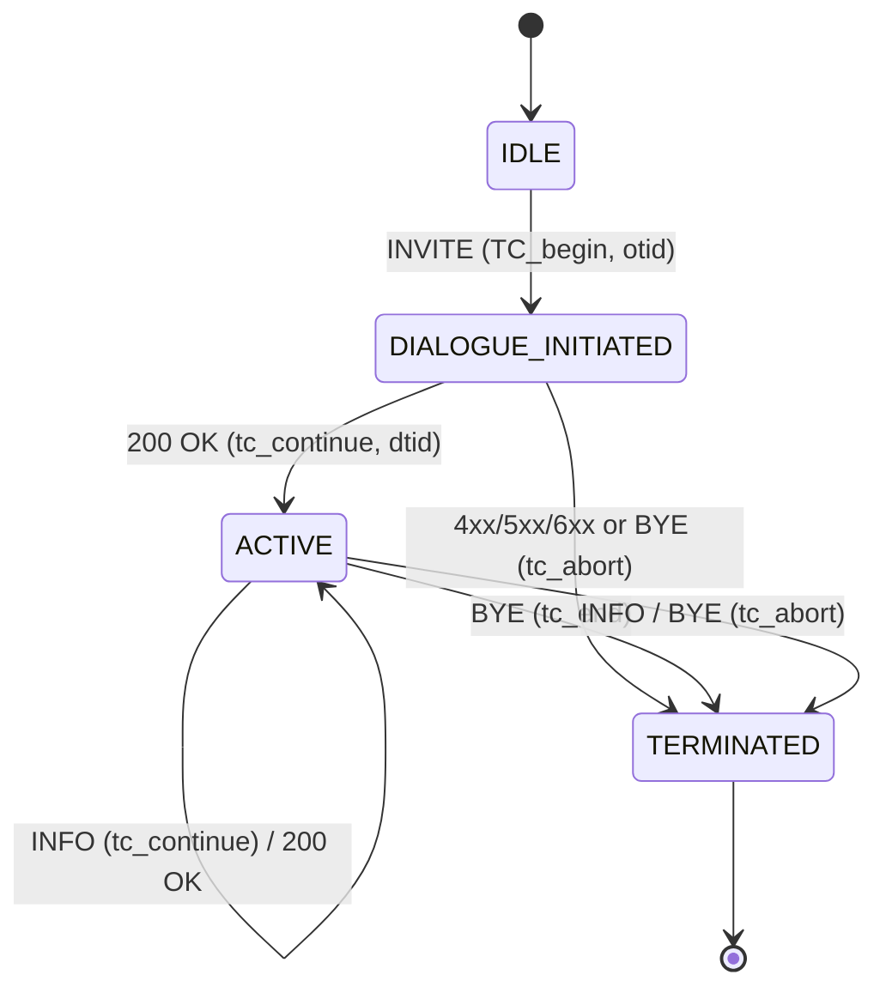
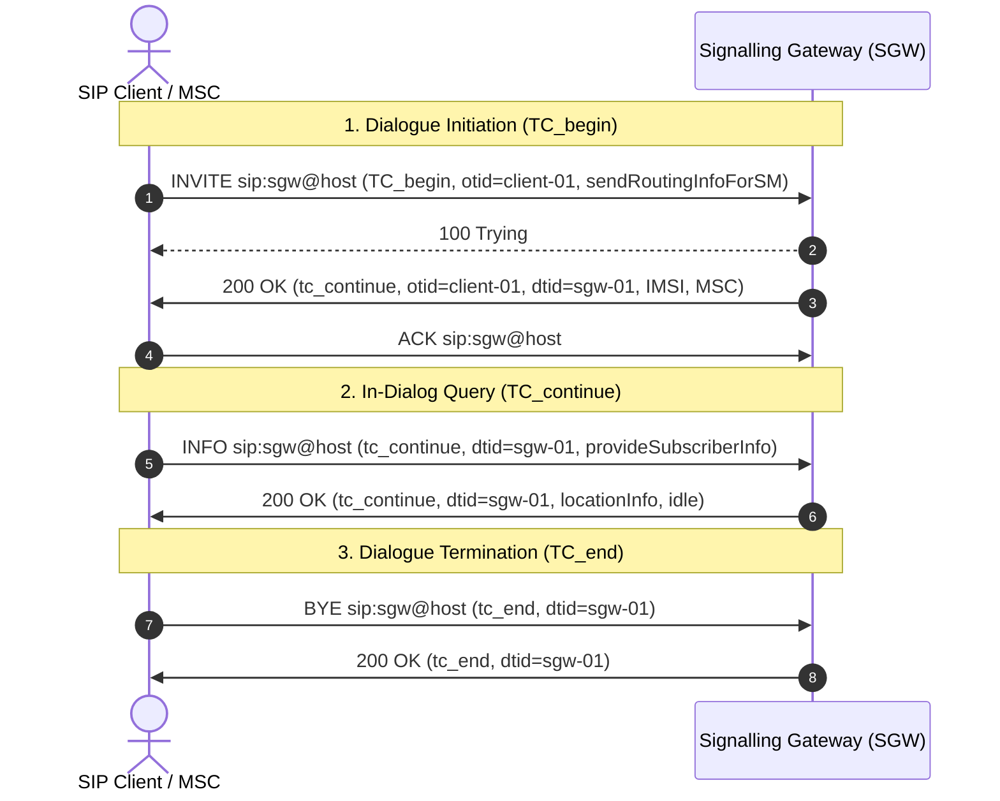
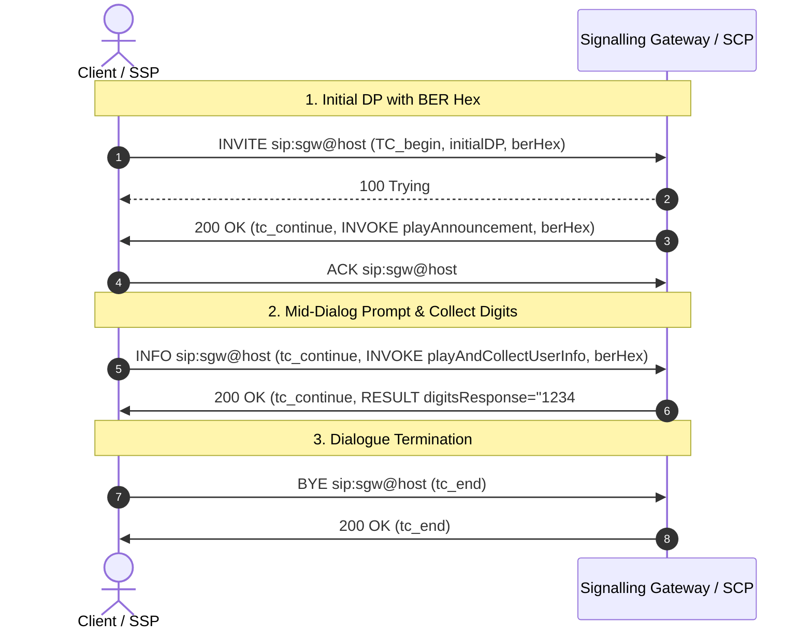
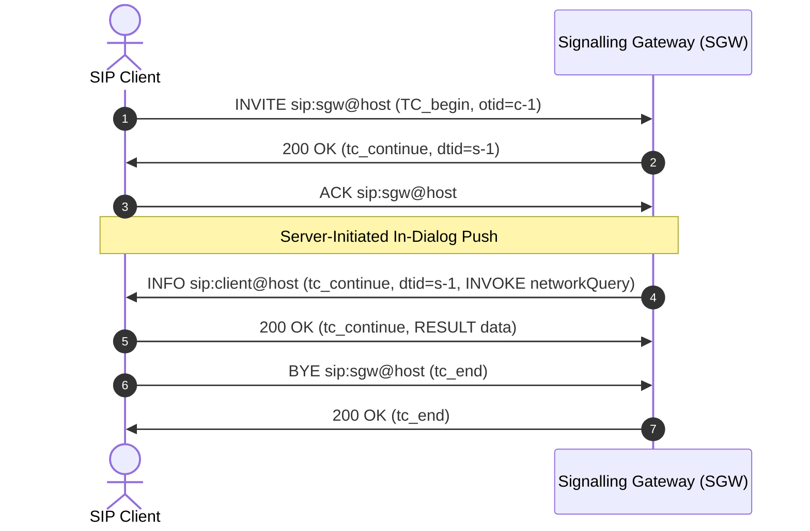

# Signalling Gateway (SGW) - TCAP over SIP

The **Dummy Signalling Gateway (SGW)** simulates telecom SS7/SIGTRAN TCAP (Transaction Capabilities Application Part - ITU-T Q.771-Q.775) transaction dialogues carried over standard SIP (RFC 3261 / RFC 6086) sessions. 

It provides JSON and ASN.1 BER (ITU-T X.690) payload encoding for both **GSM MAP** and **CAMEL / INAP** (3GPP TS 29.078 / ITU-T Q.1218) operations.

---

## 1. Protocol Architecture & SIP Mapping

TCAP dialogue primitives are mapped onto SIP messages exchanged with `sip:sgw@...` or `sip:tcap@...`:

| TCAP Transaction Primitive | SIP Message Mapping | Content-Type | Direction | Description |
|---|---|---|---|---|
| **`TC_begin`** | `INVITE` (or `200 OK` for server-initiated) | `application/json` | Client &rarr; SGW | Opens a new dialogue, allocates originating transaction ID (`otid`). |
| **`TC_continue`** | `200 OK` / `INFO` | `application/json` | Bidirectional | Continues dialogue, binds destination transaction ID (`dtid`), exchanges invokes/results. |
| **`TC_end`** | `BYE` (or `200 OK` to BYE) | `application/json` | Bidirectional | Closes dialogue gracefully, releases transaction IDs. |
| **`TC_abort`** | `BYE` / `INFO` / `4xx-6xx` | `application/json` | Bidirectional | Aborts dialogue due to unrecognized transaction ID or protocol error. |
| **`TC_uni`** | `MESSAGE` | `application/json` | Bidirectional | Unidirectional datagram message with no transaction state. |

---

## 2. TCAP Dialogue State Machine



---

## 3. GSM MAP Call Flow

The client sends a `TC_begin` carrying a GSM MAP `sendRoutingInfoForSM` operation in an `INVITE`. The gateway allocates `dtid`, returns IMSI routing information in `200 OK`, handles mid-dialog `provideSubscriberInfo` via `INFO`, and terminates the dialogue via `BYE` (`tc_end`).



---

## 4. CAMEL / INAP IVR Call Flow (with ASN.1 BER)

TCAP can carry ASN.1 BER-encoded INAP / CAMEL (3GPP TS 29.078) payloads. In this flow:
1. Client sends `InitialDP` in `INVITE`.
2. SGW instructs SSP to play an announcement (`playAnnouncement`, opcode 47) in `200 OK`.
3. Client prompts user and collects DTMF digits (`playAndCollectUserInfo` / `promptAndCollectUserInformation`, opcode 48) in mid-dialog `INFO`.
4. SGW returns caller entered digits (`digitsResponse: "1234#"`) in `200 OK`.
5. Client closes dialogue with `BYE` (`tc_end`).



---

## 5. Server-Initiated Push Flow

When configured, the gateway can push server-initiated requests (e.g. unsolicited MAP routing info or network-triggered inquiries) via in-dialog `INFO`:



---

## 6. Supported Operations & Opcodes

### GSM MAP Operations
- `sendRoutingInfoForSM`: Resolves MSISDN to IMSI and serving MSC/SGSN addresses.
- `provideSubscriberInfo`: Retrieves subscriber state (idle, busy) and Cell ID / Location Area Code (LAC).
- `checkIMEI`: Equipment identity register check (`whiteListed`, `greyListed`, `blackListed`).
- `forwardSM` / `mo-forwardSM` / `mt-forwardSM`: SMS transfer simulation with message reference tracking.
- `anyTimeInterrogation` (`ATI`): Location and coverage queries.

### INAP / CAMEL Operations (ITU-T Q.1218 / 3GPP TS 29.078)
- `initialDP` (`opcode: 0`): Service key, called party BCD number, calling party BCD number.
- `connect` (`opcode: 20`): Destination routing address.
- `releaseCall` (`opcode: 22`): Q.850 cause code release.
- `continue` (`opcode: 31`): Allows call processing to continue.
- `applyCharging` (`opcode: 35`): Max call duration / currency characteristics.
- `playAnnouncement` (`opcode: 47`): Inband announcement playback (`messageId`, `numberOfLoops`, `duration`).
- `promptAndCollectUserInformation` / `playAndCollectUserInfo` (`opcode: 48`): Prompts user and collects DTMF digits (`minDigits`, `maxDigits`, `endOfReplyDigit`, `cancelDigit`).
- `specializedResourceReport` (`opcode: 49`): SRF announcement completion notification.
- `digitsResponse`: Returned user digits (e.g. `"1234#"`).

---

## 7. JSON Payload Format

### `TC_begin` with CAMEL `initialDP`
```json
{
  "type": "TC_begin",
  "otid": "client-tx-001",
  "dialogue": {
    "applicationContext": "cap-gsmSSF-to-gsmSCF-AC"
  },
  "components": [
    {
      "type": "invoke",
      "invokeId": 1,
      "operation": "initialDP",
      "parameters": {
        "serviceKey": 1,
        "calledPartyNumber": "33612345678",
        "callingPartyNumber": "33698765432"
      },
      "berHex": "301e800101820a913361234567f8830a813369876543f2"
    }
  ]
}
```

### `tc_continue` with INAP `playAnnouncement`
```json
{
  "type": "tc_continue",
  "otid": "client-tx-001",
  "dtid": "sgw-tx-001",
  "components": [
    {
      "type": "invoke",
      "invokeId": 2,
      "operation": "playAnnouncement",
      "parameters": {
        "messageId": 101,
        "announcementText": "Welcome to the service",
        "numberOfLoops": 1,
        "duration": 10,
        "requestAnnouncementComplete": true
      },
      "berHex": "302e302580233021811b57656c636f6d6520746f2074686520766f69636520706f7274616c81010182010a8101ff8201ff"
    }
  ]
}
```

### `tc_continue` with `playAndCollectUserInfo`
```json
{
  "type": "tc_continue",
  "otid": "client-tx-001",
  "dtid": "sgw-tx-001",
  "components": [
    {
      "type": "invoke",
      "invokeId": 3,
      "operation": "playAndCollectUserInfo",
      "parameters": {
        "messageId": 201,
        "minDigits": 1,
        "maxDigits": 4,
        "endOfReplyDigit": "#",
        "simulatedDigits": "1234#"
      }
    }
  ]
}
```

---

## 8. Configuration

In `sip-app/src/main/resources/application.properties`:

```properties
# Dummy Signalling Gateway (SGW) Configuration
sgw.enabled=true
sgw.default-application-context=dummy-map-v3
sgw.default-dialogue-timeout-ms=30000
sgw.echo-unmapped-operations=true
sgw.require-dialogue-portion=false
sgw.auto-respond-200-on-info=true
sgw.server-info-enabled=true
```

---

## 9. Running the Test Client

Use the included test script `demo/test-sgw.py`:

```bash
# Test GSM MAP flow (sendRoutingInfoForSM -> provideSubscriberInfo -> BYE)
python3 demo/test-sgw.py

# Test CAMEL / INAP flow with ASN.1 BER (initialDP -> playAndCollectUserInfo -> BYE)
python3 demo/test-sgw.py --camel

# Test over TCP transport
python3 demo/test-sgw.py --transport tcp --camel
```
