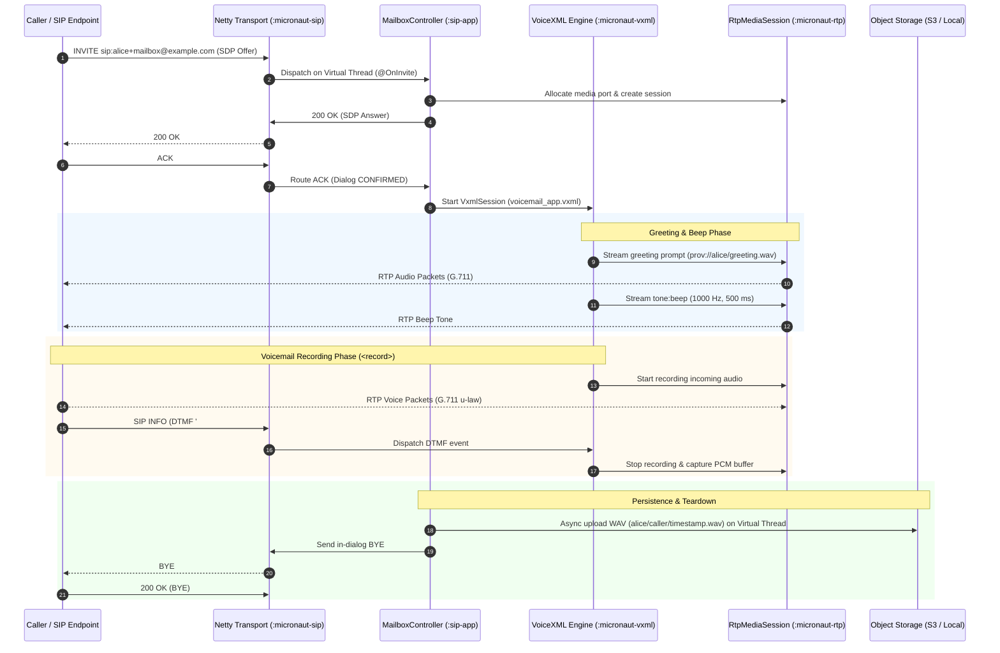

# VoiceXML-Driven Voicemail & Answering Machine Service (RFC 5552)

A production-grade, highly-concurrent Voicemail and Answering Machine service built with **VoiceXML 2.1**, **Java 25 Virtual Threads**, **Netty Zero-Copy RTP pipelines**, and **Cloud Object Storage**.

### Quick Reference

- **Standards**: [RFC 5552 (SIP Interface to VoiceXML Media Services)](https://datatracker.ietf.org/doc/html/rfc5552), [W3C VoiceXML 2.1](https://www.w3.org/TR/voicexml21/), [RFC 3261](https://datatracker.ietf.org/doc/html/rfc3261), [RFC 3550 (RTP)](https://datatracker.ietf.org/doc/html/rfc3550)
- **Application Module**: `:sip-app`
- **Controller**: [`MailboxController`](../sip-app/src/main/java/net/pilgrim/mailbox/controller/MailboxController.java)
- **Session Coordinator**: [`MailboxSession`](../sip-app/src/main/java/net/pilgrim/mailbox/service/MailboxSession.java)
- **VoiceXML Document**: [`voicemail_app.vxml`](../sip-app/src/main/resources/vxml/voicemail_app.vxml)
- **Storage Service**: [`MailboxRecordingService`](../sip-app/src/main/java/net/pilgrim/mailbox/service/MailboxRecordingService.java)
- **Integration Test Suite**: [`MailboxIntegrationTest`](../sip-app/src/test/java/net/pilgrim/mailbox/MailboxIntegrationTest.java)
- **Concurrency Benchmark**: 100 concurrent calls executed in 3.80s (100% success rate)

---

## 1. Architectural Overview

The voicemail architecture decouples telephony signaling, audio streaming, dialog state machines, and persistent object storage:

---

## 2. Key Capabilities

### 2.1 Deposit Mode (Caller Voicemail)
- **Target URI**: `sip:<owner>+mailbox@...` or `sip:mailbox@...`
- **Flow**:
  1. Plays owner greeting from storage (`prov://<owner>/greeting.wav`) or falls back to system prompt.
  2. Plays 1000 Hz beep tone prompt (`tone:beep`).
  3. Enters `<record name="voice_message" beep="false" maxtime="60s" dtmfterm="true">`.
  4. Supports termination via DTMF `#`, barge-in owner login via `*`, or caller hangup (`BYE`).
  5. Validates audio length (minimum 300ms) and uploads to `<owner>/<caller>/<timestamp>.wav`.

### 2.2 Greeting Recording Mode
- **Target URI**: `sip:<owner>+manage@...` (or DTMF `2` from management portal)
- **Flow**:
  1. Authenticates owner via PIN (`1234`).
  2. Prompts owner to record custom greeting after the tone.
  3. Records up to 30 seconds of audio, terminated with `#`.
  4. Stores audio to `<owner>/greeting.wav`.

### 2.3 Management Portal (Listen, Keep, Delete)
- **Target URI**: `sip:manage@...`, `sip:portal@...`, or pressing `*` during greeting
- **Flow**:
  1. Requests and validates PIN (`1234`).
  2. Announces unread message count.
  3. Iterates through stored voicemails playing caller ID, timestamp, and audio.
  4. Provides interactive DTMF menu:
     - `1`: Replay current message
     - `2`: Save / keep message and play next
     - `3`: Delete current message
     - `4`: Record new personal greeting
     - `9`: Exit portal

---

## 3. High-Concurrency & Zero-Copy Architecture

### 3.1 Pure Non-Blocking State Machine
- **No `latch.await()` or `.block()`**:
  - The [`VxmlSession`](../micronaut-vxml/src/main/java/net/pilgrim/vxml/runtime/VxmlSession.java) interpreter operates as a pure asynchronous state machine (`READY`, `RUNNING`, `PLAYING_PROMPT`, `WAITING_FOR_INPUT`, `RECORDING`, `TERMINATED`).
  - Executable statements evaluate via continuation callbacks: `executeExecutablesAsync(List<VxmlExecutable>, int, Consumer<FlowControl>)`.
  - Prompts transition state to `PLAYING_PROMPT` and resume execution upon playback finish or barge-in interrupt.

### 3.2 Java 25 Virtual Threads
- **Inbound SIP Request Dispatching**:
  - Netty channel handlers (`SipServerHandler`, `SipTcpServerHandler`) hand incoming requests to `VirtualThreads.run(...)`, returning Netty I/O worker threads in microseconds.
- **Persistence & Cloud I/O**:
  - WAV encoding, disk writes, and Object Storage uploads run on virtual threads, allowing blocking network I/O to unmount carrier threads automatically.

### 3.3 Zero-Copy Data Structures
- **SIP Encoding**:
  - `SipEncoder.encode(SipMessage, ByteBuf)` writes directly into Netty's `ByteBuf` using `ByteBufUtil.writeUtf8()`, eliminating `ByteArrayOutputStream` and intermediate string array allocations.
- **RTP Packetization**:
  - `RtpPacket` avoids defensive array clones with non-cloning constructors and `getPayloadDirect()`.
  - `RtpDatagramCodec` encodes directly into Netty buffers.
- **Reusable Audio Frame Buffers**:
  - `RtpAudioPlayer` and `AnnouncementPlayer` use reusable 320-byte frame buffers, eliminating 50 allocations per second per stream.
- **NIO Gathering I/O**:
  - `AudioRecording.saveWav()` writes the WAV header and PCM data to disk using `FileChannel.write(new ByteBuffer[]{header, pcm})` without composite array allocation.

---

## 4. Concurrency Benchmark (100 Concurrent Calls)

The mailbox application was subjected to high-density concurrency verification in [`MailboxIntegrationTest.testHundredConcurrentVoicemailCalls()`](../sip-app/src/test/java/net/pilgrim/mailbox/MailboxIntegrationTest.java#L844-L960):

| Benchmark Metric | Result |
| :--- | :--- |
| **Concurrent Sessions** | **100 calls in parallel** across 10 mailbox owners |
| **Worker Threads** | Java Virtual Threads (`Thread.ofVirtual().name("concurrent-100-", 0)`) |
| **RTP Media Ports** | 100 isolated UDP ports (10000–20000) allocated without collision |
| **Audio Streaming** | 100 callers streaming 400ms of G.711 u-law audio concurrently |
| **In-Dialog Signaling** | 100 SIP INFO DTMF `#` requests successfully processed |
| **Voicemails Persisted** | **100 / 100 voicemails** uploaded and verified in Object Storage |
| **Total Test Duration** | **3.80 seconds** |
| **Failed Calls** | **0 (0.0%)** |
